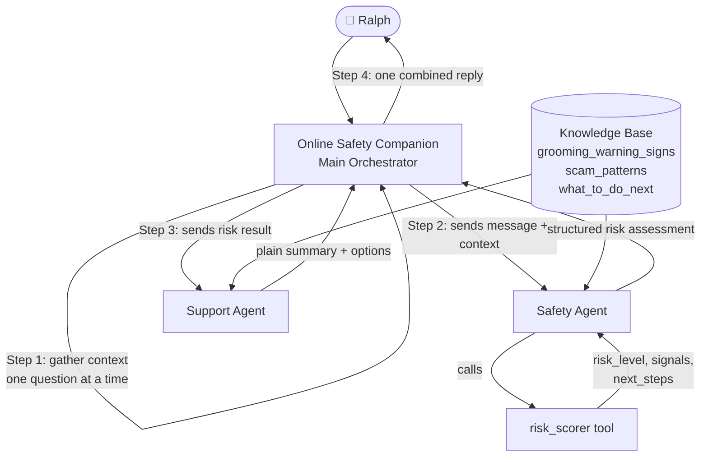

# Online Safety Companion 🛡️

> A multi-agent assistant on **IBM watsonx Orchestrate** that helps neurodivergent young adults check whether someone they met online is safe.

---

## The Problem

Neurodivergent young adults (ages 18–19) are disproportionately targeted by online predators, romance scammers, and sextortion attempts. They may find it harder to recognize manipulation tactics such as love-bombing, fake urgency, or gradual isolation from family. Existing safety resources are written for a general audience and often use abstract language that is hard to act on.

## The Solution

**Online Safety Companion** is a conversational AI assistant with a calm, plain-language persona. The user — represented by the persona "Ralph" — can paste messages, describe situations, or ask questions. The assistant gathers context one question at a time, runs a structured risk assessment, and returns a clear, non-judgmental result with 2–3 concrete options.

It detects:
- Scams (gift cards, crypto, romance, job offers)
- Grooming and sextortion patterns
- Fake urgency and secrecy requests
- Platform-migration pressure (e.g. Discord → Telegram)
- Requests for money, photos, or personal information

---

## Architecture



---

## Project Structure

```
online-safety-companion/
├── README.md
├── agents/
│   ├── online_safety_companion.yaml
│   ├── safety_agent.yaml
│   └── support_agent.yaml
├── tools/
│   └── risk_scorer.py
├── knowledge/
│   ├── grooming_warning_signs.md
│   ├── scam_patterns.md
│   └── what_to_do_next.md
├── tests/
│   ├── test_cases.md
│   └── test_risk_scorer.py
├── scripts/
│   └── deploy.sh
└── docs/
    ├── problem_solution.md
    ├── technology_used.md
    └── demo_script.md
```

---

## Setup

### Prerequisites

- IBM watsonx Orchestrate instance (SaaS or on-prem)
- watsonx Orchestrate ADK installed: `pip install ibm-watsonx-orchestrate`
- Python 3.10+
- IBM Cloud API key and watsonx Orchestrate URL (set in `.env`)

### Environment variables

Your `.env` file already has the right variables:

```bash
WATSONX_URL=https://<your-instance>.orchestrate.ibm.com
WATSONX_APIKEY=<your-ibm-cloud-api-key>
WATSONX_PROJECT_ID=<your-watsonx-project-id>
```

### Install dependencies

```bash
pip install ibm-watsonx-orchestrate
```

---

## How to Run

```bash
# 1. Activate your environment and authenticate
cd scripts
bash deploy.sh

# 2. Run the risk scorer unit tests
cd tests
python -m pytest test_risk_scorer.py -v
```

After deployment, open your watsonx Orchestrate instance and start a conversation with **Online Safety Companion**.

---

## How Bob Was Used

[IBM Bob](https://www.ibm.com/products/watsonx-orchestrate) — IBM's AI coding assistant — was used throughout this project:

- **Agent design**: Bob drafted and reviewed all three agent YAML files, checking that instructions were unambiguous, guardrails were complete, and the collaboration flow was correct.
- **Tool development**: Bob generated the initial `risk_scorer.py` with all detection rules, type hints, and docstrings, then refined the signal list based on review feedback.
- **Knowledge base**: Bob authored the three knowledge markdown files, keeping content at a pattern level so it cannot be repurposed by bad actors.
- **Test generation**: Bob wrote all 8 test conversations and the pytest test suite, including edge cases for false positives (benign chat) and high-risk scenarios (sextortion, grooming).
- **Documentation**: Bob drafted the problem/solution summary, technology overview, and the 3-minute demo script.

Bob was used inside VS Code via the Bob extension, with the workspace set to this project folder.
